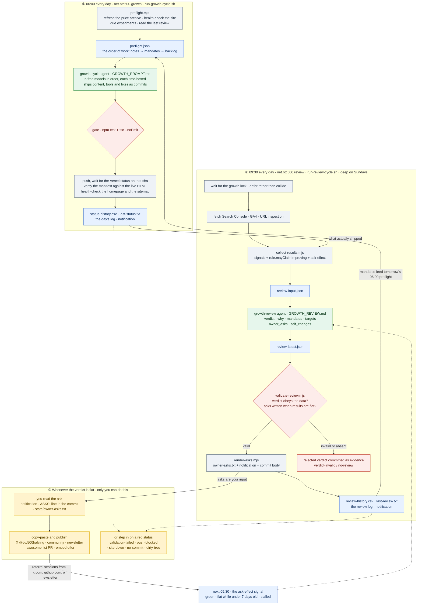

# btc500.net automation — who does what, when, and what you have to do

> Open **`architecture.html`** next to this file for the same map as a standalone
> visual page (lanes, tables, status legend) — it renders in any browser, offline.

Three actors, one working tree, two scheduled jobs.

- **Two OpenCode agents**, each driven by its own runner script and launchd job.
- **Deterministic helpers** (plain Node scripts) that measure and gate the agents
  so a model cannot grade its own homework.
- **You** — the only actor who can post, pitch or request a link.

---

## 1. The schedule

| When            | Job                                            | Runner                                   | Agent           | Deep mode                           |
| --------------- | ---------------------------------------------- | ---------------------------------------- | --------------- | ----------------------------------- |
| **06:00** daily | `net.btc500.growth`                            | `scripts/autonomous/run-growth-cycle.sh` | `growth-cycle`  | —                                   |
| **09:30** daily | `net.btc500.review`                            | `scripts/autonomous/run-review-cycle.sh` | `growth-review` | Sundays (or `BTC500_REVIEW_DEEP=1`) |
| on demand       | `install-schedule.sh --run-now growth\|review` | —                                        | —               | —                                   |

Both jobs share one checkout: whichever starts second **waits for the other's
lock** (growth waits never; review waits up to 90 minutes, then reports
`deferred` instead of interleaving).

## 2. What each agent does, and what it produces

### ① growth-cycle — 06:00

**Job:** turn the backlog into shipped, verified code and content.

1. `preflight.mjs` does the mechanical work first: refreshes
   `public/btc-usd-max.csv` (the runner commits that itself), health-checks the
   site, lists due experiment readings, and injects the reviewer's **mandates**
   and **asks** into `preflight.json`.
2. The agent works in a fixed order: preflight notes → **review mandates** →
   known defects → due experiment readings → the highest-value backlog item →
   polish. Ambition bar: a cycle should move a _measured signal_, not just add a
   file.
3. Gate: `npm test` + `tsc --noEmit`. On failure nothing is pushed and an alert
   fires — commits stay local for you.
4. Push → wait for the **Vercel commit status on that exact sha** → verify the
   agent's `last-deploy.json` manifest against the live HTML → health-check.

**Outcome:** a commit that is proven to be what production serves, or an honest
failure status. Never "it probably deployed".

### ② growth-review — 09:30

**Job:** judge whether any of that gained visitors, and refuse to pretend.

1. Refreshes its own numbers (GSC 7d, GA4 7d, URL inspection).
2. `collect-results.mjs` reduces them to signals — indexation, non-brand clicks,
   impressions, sessions, referrals, **ask-effect**, plus process signals — and
   computes `rule.mayClaimImproving` (false unless ≥2 green outcome signals, no
   regressions, fresh data).
3. The agent writes a verdict: `improving` / `stagnant` / `failing`, the `why[]`
   behind every stalled signal, ≤5 **mandates** for the next cycle, measurable
   **targets**, and — when results are flat — ≥1 **owner ask**.
4. `validate-review.mjs` enforces all of that mechanically. A verdict the data
   does not support is rejected, committed as evidence and reported as
   `verdict-invalid`.
5. `render-asks.mjs` turns `owner_asks[]` into the copy-paste file, the
   notification and the commit body.

**Outcome:** a verdict you can trust, work ordered for tomorrow, and a specific
action ordered for you.

### ③ You

The automation can publish to btc500.net and nothing else. Every channel that
brings strangers in — a post, a community comment, a newsletter, a link — needs
you. When results are flat, that is the highest-leverage thing in the system.

## 3. Where to check the results

| What you want to know           | Where to look                                                                                                                        |
| ------------------------------- | ------------------------------------------------------------------------------------------------------------------------------------ |
| Did this morning's run ship?    | `~/.local/state/btc500-growth/last-status.txt`, the notification, or `status-history.csv`                                            |
| What did it actually do?        | `~/.local/state/btc500-growth/YYYY-MM-DD.log`, `attempts/*.log`, `git log`                                                           |
| What did the reviewer conclude? | `last-review.txt`, `review-history.csv`, `review-YYYY-MM-DD.log`, `scripts/autonomous/review-latest.json`                            |
| **What am I supposed to do?**   | `~/.local/state/btc500-growth/owner-asks.txt`, the notification, or the `ASKS:` lines in the commit                                  |
| Did I already do it?            | `scripts/autonomous/outreach/STATUS.md` — one row per ask and pitch: channel, recipient, handed over, due, sent, date sent, proof metric                                                          |
| Are the numbers moving?         | `results-history.csv`, `review-input.json`, and the sources: Search Console + GA4 via `npm run search-console` / `npm run analytics`. Referral-only line: `npm run referrals`                    |
| Is the site fine?               | <https://btc500.net>, `/sitemap.xml`, `/btc-usd-max.csv`, the notification                                                           |
| Is the deployment real?         | GitHub commit status (Vercel), `scripts/autonomous/last-deploy.json` vs the live HTML                                                |
| Why did we choose this work?    | `BTC500_GROWTH.md` (memory), `scripts/autonomous/experiments.json`, `GROWTH_PROMPT.md`                                               |

Statuses worth reading closely:

- **growth:** `shipped` ✅ · `archive-only` ✅ · `shipped-unverified` /
  `archive-unverified` / `push-blocked` / `validation-failed` ⚠️ ·
  `deploy-failed` ⚠️ · `site-down` 🚨 · `no-commit` / `dirty-tree` ⚠️
- **review:** `improving` ✅ · `stagnant` ⚠️ · `failing` 🚨 ·
  `verdict-invalid` 🚨 (the reviewer broke its own rules) · `no-review` ⚠️ ·
  `deferred` ⏸ · `validation-failed` / `push-blocked` ⚠️

## 4. Where the automation needs you

| Trigger                                           | What it is asking for                                                                                                                                              |
| ------------------------------------------------- | ------------------------------------------------------------------------------------------------------------------------------------------------------------------ |
| A `stagnant` or `failing` verdict                 | **An ask in `owner-asks.txt`** — the post to publish, written out in full, with the link, the best time, and the metric that proves it worked. Due within 14 days. |
| A mandate marked `owner` (or "prepare the asset") | The cycle prepares the chart/draft; you publish it.                                                                                                                |
| A red status in the notification                  | Something mechanical needs a human: failing tests, blocked push, site down, or all 5 models exhausted (`no-commit`).                                               |
| Anything external to the repo                     | Accounts, submissions, permissions — the agents are denied them by policy.                                                                                         |
| Two weeks of `stalled` on `ask-effect`            | The channel itself is wrong: pick a different one (the reviewer will say so and re-ask).                                                                           |

**The loop back:** after you publish, nothing needs confirming by hand — GA4
records the referral sessions (`x.com`, `twitter.com`, `github.com`, the
newsletter's domain) and the next 09:30 run scores them in the `ask-effect`
signal. Green means it worked; `stalled` after 7 days means restate it narrower.
